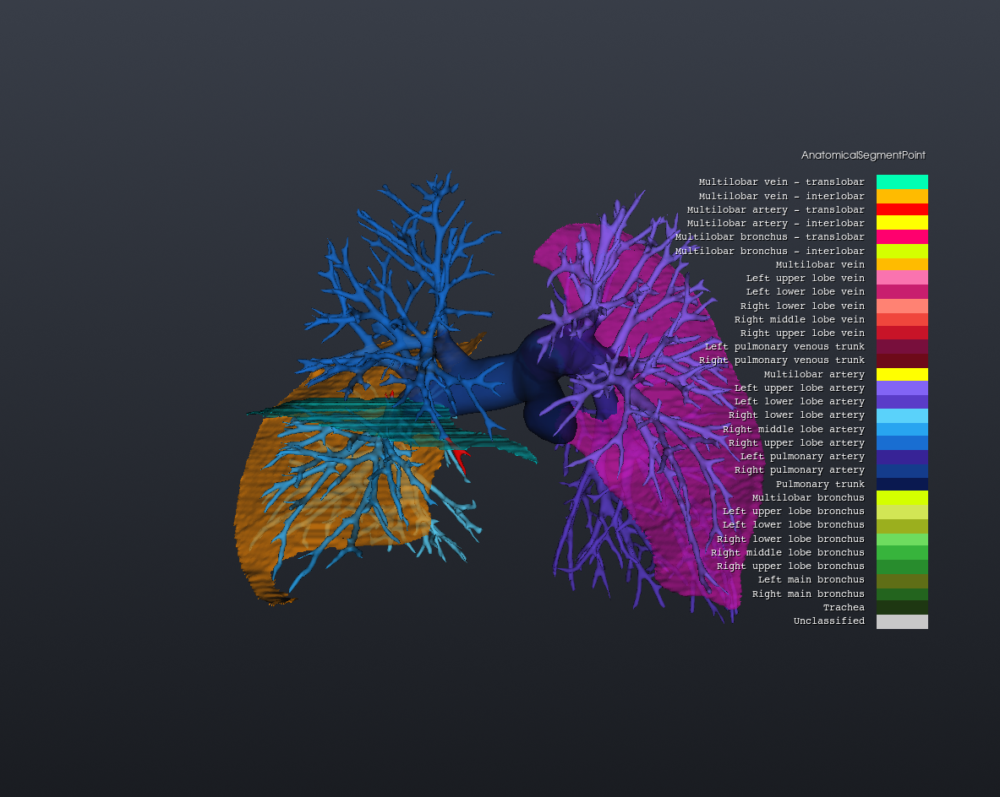
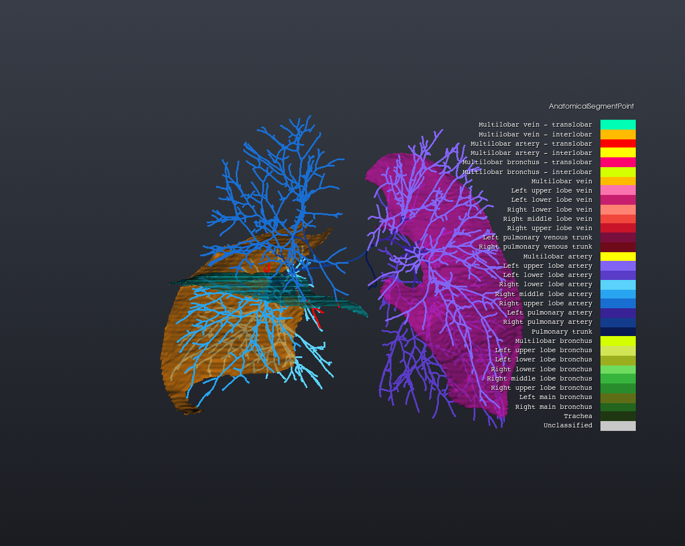

<p align="center"></p>

# VeScan-field

**VeScan** — a toolkit for vessel tree cutting, anatomical branch assignment, and crossing-vessel characterization.

Given a set of vessel segmentations (arteries, veins, pulmonary airways) as input, VeScan turns the raw vessel tree into a fully labeled anatomical graph. Starting from the segmentation masks and the network's own continuous output (a ranked store written by [haversack](https://github.com/edoardoedr/haversack)), it:

- builds a **hierarchical centerline tree** (trunk → bifurcations → branches) from the segmentation network's continuous field, **without VMTK**;
- assigns every branch/bifurcation to its corresponding **anatomical segment** (lobar bronchus/artery/vein, main trunk, ...);
- detects **crossing vessels** (branches that cross into a neighbouring pulmonary lobe), together with the **interlobar fissures** they cross;
- **cuts the vessel tree** to a chosen number of generations.

Everything is driven by a single JSON config file, for one patient or an entire dataset processed in parallel, with numpy, scipy and `vtk` only: no `vtkvmtk` build is needed.

VeScan-field is the VMTK-free twin of [VeScan-vmtk](https://github.com/edoardoedr/VeScan-vmtk). The two run the same stages and write the same files; they differ only in how the centerlines are computed.

## Table of contents

- [Overview](#overview)
- [Installation](#installation)
- [Quick start](#quick-start)
- [Experiment configuration (JSON)](#experiment-configuration-json)
- [Visualizing results in 3D Slicer](#visualizing-results-in-3d-slicer)
- [Repository layout](#repository-layout)
- [The pipeline in detail](#the-pipeline-in-detail)
- [main_field.py and the vescan_field package](#main_fieldpy-and-the-vescan_field-package)
- [Important conventions](#important-conventions)
- [Credits](#credits)

## Overview

VeScan works on the per-patient folders written by `batch_segment.py` of [edoardoedr/haversack](https://github.com/edoardoedr/haversack), a fork of Mike Halle's [haversack](https://github.com/mhalle/haversack). Each folder holds two things:
- the binary masks `<name>.nii.gz`: the five lobes, `lung_arteries`, `lung_veins`, `lung_airways`, `lung_airways_wall` (TotalSegmentator's names);
- the **ranked store** `lung_vessels.duckn.zip`: for every voxel, the classes in rank order and how many logits each one is behind the winner.

From these, VeScan builds a **hierarchical centerline tree** (trunk → bifurcations → branches), including:

- conversion of the masks into closed surfaces, with the lobes merged into one labelled mesh and the **interlobar fissures** extracted from it;
- the **margin** of each structure, the network's continuous field interpolated onto the CT grid, positive inside the vessel and zero on its boundary;
- a seedless **TEASAR** skeleton of the field, refined onto the ridge of the wall distance, with a sub-voxel radius;
- the bifurcation graph, oriented from the inflow (pulmonary trunk, trachea) or from the atrial confluence (veins), as groups of branches and bifurcations;
- assigning each branch/bifurcation to the pulmonary lobe(s) it reaches ("lobe reachability");
- classifying each branch/bifurcation into a precise anatomical segment (trachea/bronchi, pulmonary trunk/arteries, venous trunks/veins);
- detecting **crossing vessels**, the branches that cross an interlobar fissure into a neighbouring lobe, and classifying each one as interlobar or translobar, with lengths and angles;
- labelling the vessel surface with all of the above, for visualization;
- as the last step, cutting the tree to a chosen number of generations and clipping the labelled surface at the cut.

Each stage is a plain Python package under `vescan_field/stages/`, run in-process by `vescan_field/orchestrator.py`, which `vescan_field/main.py` calls once per patient: for a single patient, or for a whole dataset processed in parallel. A single JSON config file drives everything: which stages run, every tuning parameter, and whether to process one patient or many.

VeScan-field also runs inside 3D Slicer, through the extension [SlicerVeScan](https://github.com/edoardoedr/SlicerVeScan).

## Installation

Python ≥ 3.11. The dependencies (`numpy`, `scipy`, `vtk`, `SimpleITK`, `zarr`, `pyfqmr`) come with the package; no VMTK and no GPU are needed.

```bash
pip install "vescan-field @ git+https://github.com/edoardoedr/VeScan-field"

# or, to work on the code
git clone https://github.com/edoardoedr/VeScan-field
cd VeScan-field
pip install -e ".[test]"
python -m pytest tests/field
```

- **zarr version**: zarr 3.1 needs numpy 2; with numpy 1.26 pip picks zarr 3.0.
- **Segmentation**: the masks and the store come from the haversack fork. Its own environment (PyTorch, a GPU) is needed only to segment the CTs, not to run VeScan; see its `README_batch_segment.md`.

## Quick start

1. **Segment** the CT scans with `batch_segment.py` of the haversack fork. You get one folder per patient with the masks and `lung_vessels.duckn.zip`.
2. **Configure**: copy [`configs/field/example.json`](configs/field/example.json), which has every key with its standard value, and set the three folders:

   ```json
   "batch": {
     "enabled": true,
     "patients_root_dir": "/data/my_dataset/segmentations",
     "surfaces_root_dir": "/data/my_dataset/surfaces",
     "results_root_dir": "/data/my_dataset/results",
     ...
   ```

3. **Run** from the repo root (or with the `vescan-field` command after `pip install`):

   ```bash
   python main_field.py --config my_dataset.json                     # every patient, one after the other
   python main_field.py --config my_dataset.json --jobs 4            # 4 patients at a time
   python main_field.py --config my_dataset.json --structures artery # one structure only
   ```

4. **Look** at `results/<patient>/final_export_<structure>/` in 3D Slicer (see [below](#visualizing-results-in-3d-slicer)), and collect the crossing statistics of the whole dataset with `python statistics_scripts/aggregate_statistics.py results/ -o crossings.xlsx`.

A structure takes about 30 s on a laptop CPU.

## Experiment configuration (JSON)

The only input of `main_field.py` is a JSON config ([`configs/field/example.json`](configs/field/example.json) lists every key). On the command line there are only:
- `--structures`: a subset of the enabled structures;
- `--jobs N`: N patients at a time, one process each, default 1.

**Rules.**
- Every key has a default, and `null` means "the default", so an experiment file only needs what it changes.
- The example's values are the code defaults: the standard parameters of our runs.
- An **unknown key is an error**, as is a wrong type: a typo is caught, not silently ignored.
- Relative paths are relative to the config file.

| Section | What it sets |
|---|---|
| `batch.enabled` | `false`: the three folders below belong to **one** patient. `true`: every subfolder of `patients_root_dir` that contains the store is a patient, with its own subfolder in the other two |
| `batch.patients_root_dir` | the segmentations: masks `<name>.nii.gz` and the store |
| `batch.surfaces_root_dir` | the patient-level surfaces: lobes, lobe mesh, fissures, raw vessel surfaces |
| `batch.results_root_dir` | the per-structure outputs (`final_export_<structure>/`) and `pipeline.log` |
| `batch.store` | the store's file name (`lung_vessels.duckn.zip`) |
| `batch.structures.<artery\|veins\|airways>` | `enabled`, and `classes`: the masks / store classes whose union is the structure. Airways = `lung_airways` + `lung_airways_wall`: with the lumen alone the radii come out about half |
| `pipeline.stages.<name>` | one switch per stage |
| `pipeline.debug_files` | `true`: also write the files no stage reads (Slicer markups, legends, the margin volume), in `supporting_files/debug/` |
| `pipeline.lobes` | `enabled`: the active lobes (`RUL RML RLL LLL LUL`); `names`: mask names, if not TotalSegmentator's |
| `pipeline.field` | `pad_voxels`: padding of the store box when building the margin |
| `pipeline.<stage>` | that stage's parameters, described in [its page](#the-pipeline-in-detail) |
| `logging` | `level` (DEBUG/INFO/WARNING/ERROR) and `file_name` (`pipeline.log` in each patient's results folder; `null` = console only) |

**Parameters you are likely to change.**
- `pipeline.clip.max_generations` (8): how many generations the cut keeps.
- `pipeline.clip.generation_lobes` (`null` = all): the lobes where `max_generations` applies, e.g. `["RUL", "RML"]`; the other lobes are not cut (needs the anatomy stage).
- `pipeline.surfaces.preprocess.target_points` (100000): the size of the vessel surface.
- `pipeline.lobes.enabled`: to run on a subset of the lobes. The labels keep the five-lobe scale, and the vessels of an excluded lobe stay on the main right/left tier instead of becoming unclassified.

**Batch behaviour.**
- A failing patient is logged with its traceback, and the batch goes on.
- With `--jobs N` each patient logs only to its own `pipeline.log`.
- The console shows a progress line at the start, after each finished patient and every minute:

  ```
  [#########.....................] 3/10 30% | 1 failed | 4.2 min, ETA 9.8 min
  ```

## Visualizing results in 3D Slicer

Every `.vtk` file loads directly as a Model in 3D Slicer (or any VTK viewer). Colour it with **Display > Scalars > Active Scalar**, using the matching colour table from the repo root: load the CSV in the Colors module as "Categorical Labels".

| Surface (`branch_labeled_surface.vtk`) | Centerline (`anatomical_segments.vtk`) |
|---|---|
|  |  |

The artery tree of one patient, coloured by `AnatomicalSegmentPoint` with `ColorTableVessels_EN.csv`; the translobar vessels (red) cross the right horizontal fissure.

The files of one structure, in `final_export_<structure>/`:

| File | What it is | Key scalars | Colour table |
|---|---|---|---|
| `anatomical_segments.vtk` | the labelled **centerline** | `AnatomicalSegment(Point)`, `CrossingType(Point)`, `LobeLabel(Point)` | [`ColorTableVessels_EN.csv`](ColorTableVessels_EN.csv), [`ColorTableCrossings_EN.csv`](ColorTableCrossings_EN.csv), [`ColorTableLobeLabel_EN.csv`](ColorTableLobeLabel_EN.csv) |
| `branch_labeled_surface.vtk` | the whole **vessel surface** | the same, plus `GroupId`, `Generation`, `Length`, `AverageRadius` | the same |
| `clipped_surface.vtk` | the surface **cut to N generations** | the same as `branch_labeled_surface.vtk` | the same |
| `cut_centerline.vtk` | the centerline cut to N generations | `GroupId`, `Generation` | any |

Once per patient, in the surfaces folder:
- `lobe_segments.vtk` has `LobeSegment_Vein/_Artery/_Airway`, `FissureContact`, `Fissure`;
- `lobe_fissures.vtk` has the fissure sheets alone.

Their colour table is [`ColorTableLobesFissures_EN.csv`](ColorTableLobesFissures_EN.csv).

**Use the `...Point` arrays for the most precise view.** `AnatomicalSegmentPoint` is resolved per centerline point, not per branch, so a boundary (a lobe entry, the start of a crossing) shows where it happens instead of painting a whole branch one colour.

## Repository layout

```
VeScan-field/
├── main_field.py                  # the CLI: python main_field.py --config config.json
├── vescan_field/
│   ├── main.py                    # patients, batch, --jobs, progress
│   ├── orchestrator.py            # one patient: patient-level stages, then each structure
│   ├── config.py                  # typed schema of the JSON config (defaults = standard values)
│   ├── paths.py                   # every output path, defined once
│   ├── log.py  io.py              # logging; JSON, images, Slicer markups
│   ├── store.py  field.py         # ranked-store reader; CT geometry and the margin
│   ├── surface.py                 # VTK surface utilities shared by the stages
│   ├── group_tree.py              # the group graph of the topology JSON
│   ├── centerline_distance.py     # VMTK's radius-weighted nearest segment, in numpy
│   ├── lobes.py  threads.py       # lobe order/names/sides; threads per process
│   └── stages/
│       ├── surfaces/              # convert, preprocess, lobe_segments
│       ├── centerlines/           # extract, graph, skeleton, refine, topology, tree, export_tree
│       ├── anatomy/               # reachability, segments, crossings, labels, statistics
│       ├── surface_labels/        # transfer
│       └── clip/                  # cut, clip_surface
├── configs/field/example.json     # every key, standard values
├── tests/field/                   # pytest suite (synthetic phantoms)
├── docs/                        # one page per stage (surfaces, centerlines, anatomy, surface_labels, clip)
├── docs/images/                  # logo, 3D Slicer screenshots
├── statistics_scripts/aggregate_statistics.py  # statistics.json of many patients -> .xlsx
├── ColorTable*_EN.csv             # Slicer colour tables
└── pyproject.toml
```

## The pipeline in detail

Five stages, run in this order. Each page describes the stage's method, inputs, outputs and parameters:

| Stage | What it does | Page |
|---|---|---|
| `surfaces` | masks → closed surfaces; lobe mesh and fissures; the vessel surface decimated to N points | [surfaces](docs/surfaces.md) |
| `centerlines` | the store's margin → TEASAR → oriented tree → groups and `05_` files | [centerlines](docs/centerlines.md) |
| `anatomy` | lobes reached by each group; anatomical segment per group and per point; crossing vessels; statistics | [anatomy](docs/anatomy.md) |
| `surface_labels` | the centerline's labels onto the whole surface | [surface_labels](docs/surface_labels.md) |
| `clip` | cut the tree at N generations, clip the labelled surface there | [clip](docs/clip.md) |

Outputs:

```
surfaces_root_dir[/<patient>]/                 once per patient (stage surfaces)
    lung_*_lobe_*.vtk  lobe_segments.vtk  lobe_segments.json  lobe_fissures.vtk
    <first class>.vtk                          raw surface of each structure
results_root_dir[/<patient>]/
    pipeline.log  patient_summary.json
    final_export_<structure>/
        anatomical_segments.vtk  branch_labeled_surface.vtk  clipped_surface.vtk  cut_centerline.vtk
        statistics.json  statistics.csv        the crossing vessels
        run_summary.json                       parameters, QA, counts, per-stage results, timings
        supporting_files/                      read by the later stages
            01_preprocessed.vtk  05_branch_tree.vtk  05_branch_tree_topology.json  06_cut_points.mrk.json
            debug/                             only with pipeline.debug_files
```

## main_field.py and the vescan_field package

- **`main_field.py`** (repo root) calls `vescan_field.main.main()`, which:
  - reads the config and finds the patients;
  - runs them one after the other, or `--jobs` at a time, each in its own process;
  - shares the CPU between the processes: each gets the container's CPU quota divided by N threads, a Jupyter server can show 128 cores and allow 16;
  - logs each patient to its own `pipeline.log`.
- **`orchestrator.py`**:
  - for each patient, runs the patient-level stages once (the lobes), then, for each structure, loads its masks and builds its margin from the store;
  - runs the enabled stages in order;
  - writes `run_summary.json` and `patient_summary.json`.
- **`config.py`** is the typed schema (dataclasses) the JSON is parsed into. **`paths.py`** is the only place where file names and folders are defined.
- **A stage** is a package `vescan_field/stages/<name>/` whose `__init__.py` has `run_patient(pctx, cfg)` (once per patient) and/or `run(ctx, cfg)` (per structure), with `cfg` its own `pipeline.<name>` section. A stage can be switched off and re-run alone on an existing results folder: it reads the previous stages' files from disk.

## Important conventions

- **LPS everywhere**: surfaces and markups are written in LPS (`SPACE=LPS` on the second line of the `.vtk`, `"coordinateSystem": "LPS"` in `.mrk.json`), as 3D Slicer exports them.
- **`.vtk`, not `.stl`**: STL stores float32 coordinates with no connectivity, and rebuilding it can split a mesh.
- **`GroupIds` vs `GroupId`**: `05_branch_tree.vtk` has VMTK's names (`GroupIds`, `Blanking`) for compatibility, and the friendly `GroupId` / `IsBifurcation` / `Generation` / `Length` / `AverageRadius`, which every later stage reads.
- **A bifurcation is a point** (the junction, with 0.5 mm before and after). In VMTK it is the zone where the inscribed spheres of the branches overlap. Bifurcations stay binary, so generations are about twice VMTK's: compare trees by anatomical segment, not by generation.
- **Labels**: the values are VeScan's (see the [anatomy](docs/anatomy.md) page), and the names are those of the `_EN` colour tables.

## Credits

Thanks to [Mike Halle](https://github.com/mhalle):

- [haversack](https://github.com/mhalle/haversack) is the segmentation pipeline whose outputs VeScan reads. VeScan uses it through the fork [edoardoedr/haversack](https://github.com/edoardoedr/haversack).
- The field-based approach to centerline extraction (centerlines computed from the network's continuous output instead of the binary mask) is his. He implements it in [thalweg](https://github.com/mhalle/thalweg), a field-based successor of VMTK. VeScan-field has its own implementation and does not depend on thalweg.
- The decoding of the ranked store reproduces [rankfield](https://github.com/mhalle/rankfield) (Apache-2.0).
